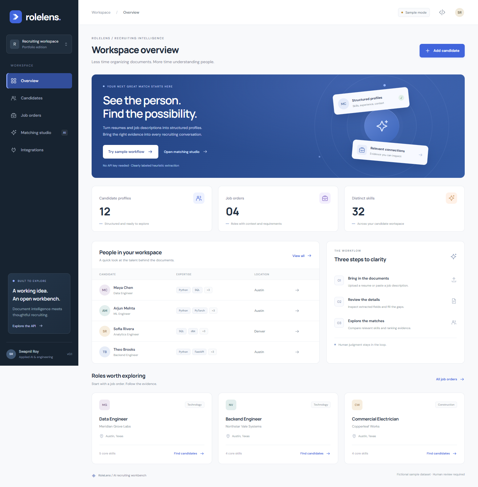
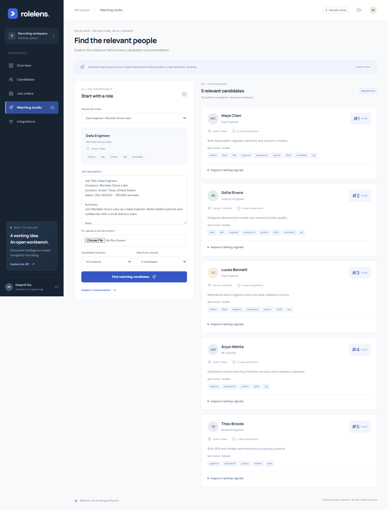
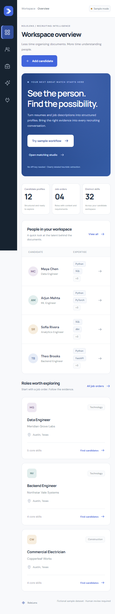
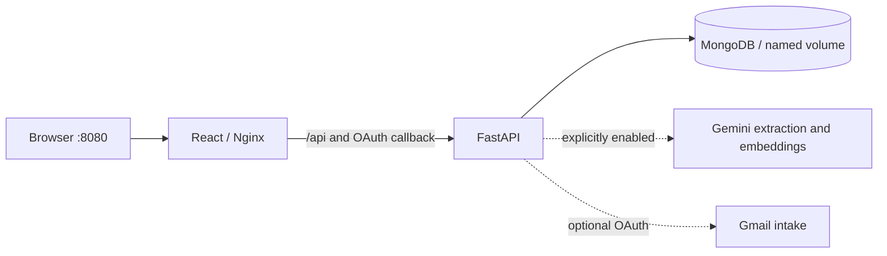

# RoleLens

### AI recruiting workbench

**Turn unstructured recruiting documents into reviewable profiles and explainable candidate shortlists.**

RoleLens is a working portfolio POC built with React, FastAPI, MongoDB, and optional Gemini APIs. It explores a practical engineering question: how can document intelligence support recruiting while keeping extraction errors, missing information, and ranking evidence visible?



## Try it locally

Install Docker Desktop with the Compose plugin, start its engine, and run:

```sh
docker compose up --build
```

- Workspace: **http://localhost:8080**
- Interactive API docs: **http://localhost:8080/api/docs**
- Readiness: **http://localhost:8080/api/ready**

No environment file, API key, cloud database, or Gmail account is needed. The default stack seeds **12 fictional candidates and four job orders** into a local database. First startup downloads dependencies and images; subsequent starts reuse them.

The frontend is the only published service, bound to your computer's loopback interface. FastAPI and MongoDB communicate on the internal Compose network.

## A two-minute walkthrough

1. Open **Overview → Try sample workflow** to extract a fictional resume.
2. Compare its original text with the editable fields. Sample mode uses limited text heuristics, clearly labeled in the review screen.
3. Correct a field and save the candidate. Open the candidate library to inspect or edit the saved record.
4. Open **Matching studio**, select the **Data Engineer** job at **Meridian Grove Labs**, and run matching.
5. Inspect matched terms and ranking signals. Filter to Austin to narrow the search.

The samples are downloadable from the intake page. Bulk upload supports multiple documents or a folder; each document is reviewed before saving. Gmail is an optional, separate integration.



<details>
<summary>Mobile workspace</summary>



</details>

## What works

| Capability | Keyless sample mode | Gemini mode |
| --- | --- | --- |
| Candidate and job libraries, editing, location filters | Yes | Yes |
| Text PDF, DOCX, TXT intake | Heuristic extraction + human review | Structured AI extraction + human review |
| Scanned PDFs and PNG/JPEG/WEBP images | Actionable unsupported-mode message | Gemini vision, subject to provider availability |
| Candidate ranking | Keyword evidence | Keyword + compatible semantic embeddings |
| Explicit compensation extraction | Yes | Yes; optional estimates are labeled unverified |
| Gmail draft review | Optional OAuth setup | Optional OAuth setup |

## Architecture



One root Compose file coordinates three services, health checks, and persistence. The frontend has its own build image; FastAPI serves the API independently. Nginx provides a same-origin browser API, avoiding frontend API-host configuration and keeping server credentials out of browser bundles.

The backend separates document parsing, the AI boundary, structured schemas, storage, email intake, and matching. The frontend separates overview, records, intake/review, matching, and integrations into focused pages with shared form components.

### Extraction and review

Text parsers use pdfplumber/PyMuPDF and DOCX XML parsing. Scanned PDFs are rendered to images for the live vision path. Gemini responses are validated against Pydantic schemas. Invalid output and transient provider failures fall back to text heuristics where readable text exists; the response and interface expose the fallback. An unreadable image never silently becomes a blank saved profile.

The service uses explicit request timeouts and at most one application retry for transient errors. There is no automatic switch to another model or a paid provider. Documents are treated as source material and every extracted record can be corrected before saving.

### Matching design

1. Apply requested location filters to candidate records.
2. Rank positive keyword overlap between the job text and candidate context.
3. When available, rank compatible embeddings using local cosine similarity or optional Atlas vector search.
4. Fuse available channels with reciprocal rank fusion: `sum(1 / (60 + rank))`.

Missing vectors and zero-evidence channels contribute no ranks. Atlas and local cosine similarity are alternatives within one semantic channel, so the same semantic evidence is not counted twice. Embeddings record their model, dimensions, and content hash. Model/dimension mismatches are excluded; changed profiles are regenerated on save or by the reindex command.

Scores are **ranking signals**, not probabilities of job performance. Keyword retrieval can favor exact wording; semantic similarity can still be wrong. Ranking does not use inferred age or the experimental activity fields. This POC does not make hiring decisions.

## Enable Gemini's free tier

Create a free-tier project and API key in [Google AI Studio](https://aistudio.google.com/api-keys). Copy `.env.example` to `.env` at the repository root, then set:

```dotenv
AI_MODE=gemini
GEMINI_API_KEY=your-local-key
GEMINI_EXTRACTION_MODEL=gemini-3.5-flash-lite
GEMINI_EMBEDDING_MODEL=gemini-embedding-2
EMBEDDING_DIMENSIONS=768
```

Restart the backend with the new environment, then index existing sample candidates:

```sh
docker compose up -d backend
docker compose exec backend python -m app.cli reindex
```

New and edited candidates attempt embedding generation automatically. Reindex skips unchanged, compatible records and exits with an error count if some requests fail. Re-run it after quota recovery. Without usable semantic evidence, matching continues with a visible keyword-only mode.

Free-tier availability and quotas belong to the provider. A paid/billing-enabled project can incur charges; this application cannot enforce your account's billing tier. Google lists free-tier content as usable for product improvement, so use fictional documents for this showcase. Consult [current pricing](https://ai.google.dev/gemini-api/docs/pricing), [rate limits](https://ai.google.dev/gemini-api/docs/rate-limits), and [data terms](https://ai.google.dev/gemini-api/terms).

The application no longer requires OpenAI credentials or its SDK. API keys are backend-only; `.env`, token files, uploaded attachments, and OAuth configuration are excluded from Git and image build contexts.

## Data and maintenance

```sh
# Idempotent: inserts missing sample IDs without overwriting edits
docker compose exec backend python -m app.cli seed

# Destructive: resets the entire rolelens_demo database, including added records
docker compose exec backend python -m app.cli reset-demo

# Stops containers while preserving saved records
docker compose down
```

Reset refuses any database name other than `rolelens_demo`. Seeding also only operates on that database. Disable seeding with `SEED_DEMO=false` when using a different dataset. All included names, organizations, documents, and engagement signals are fictional.

### Optional MongoDB Atlas

Set `MONGODB_URI` to your own Atlas connection and choose a database. Local cosine search works without an Atlas search index. For Atlas retrieval, set `ATLAS_VECTOR_ENABLED=true` and create `candidate_vector_index` on `profile_embedding` using cosine similarity and the configured dimensions (default 768), with `_id` indexed as a filter field:

```json
{"fields":[
  {"type":"vector","path":"profile_embedding","numDimensions":768,"similarity":"cosine"},
  {"type":"filter","path":"_id"}
]}
```

The query restricts Atlas retrieval to already-compatible, location-filtered candidate IDs. If the index or Atlas search is unavailable, local cosine search is used. Atlas and in-process semantic scores can use different scales; ranking fusion uses order, not absolute cross-provider scores.

## Optional Gmail intake

Gmail is disabled by default. [The integration guide](docs/gmail.md) explains OAuth setup, requested access, draft review, and local token storage. The demo performs no scheduled mailbox polling. Connecting and processing are explicit user actions.

## Native development

Use Python 3.11+ and Node 22. Keep local MongoDB running (or publish a loopback port for a separate MongoDB instance). For native development, use `MONGODB_URI=mongodb://localhost:27017` in the root `.env` rather than Compose's service hostname.

Backend, from the repository root:

```sh
python -m venv .venv
# Windows PowerShell
.venv\Scripts\Activate.ps1
# macOS/Linux: source .venv/bin/activate
pip install -r backend/requirements-dev.txt
cd backend
uvicorn app.main:app --reload
```

Frontend, in a second terminal:

```sh
cd frontend
npm ci
npm run dev
```

Vite serves port 5173 and proxies `/api` and `/auth/callback` to FastAPI on 8000. For native Gmail setup, set `FRONTEND_REDIRECT_URL=http://localhost:5173` and `GMAIL_OAUTH_REDIRECT_URI=http://localhost:5173/auth/callback` in `.env`, and register that exact callback with Google.

## Verification

```sh
# From the repository root with the virtual environment active
python -m pytest backend/tests -q

cd frontend
npm ci
npm run build

# Start Compose first. Install a browser for the automated workflow:
npx playwright install chromium
npm run test:e2e
npm run screenshots
```

On Windows with Edge installed, set `$env:BROWSER_CHANNEL='msedge'` to use it instead of downloading Chromium. Browser tests create additional fictional candidate/job records; reset the demo afterward when you want the original sample counts. Screenshot capture reads the current stack without adding records.

Tests cover extraction, review/save/edit, file-type handling, seeding, reset isolation, readiness, optional Gmail gating, mocked Gemini failures, embedding compatibility, matching evidence, bulk intake, and responsive browser navigation. CI builds the stack and runs the same core workflow. Screenshot assets show the actual local application.

See the [local verification record](docs/verification.md) for completed checks and untested external integrations. Run `python scripts/check_public.py` against the staged Git index before publishing.

## Limits and next steps

This is a local portfolio POC: no authentication, tenancy, background job queue, production deployment, or validated hiring outcomes. Experimental activity clustering is isolated under Integrations and explicitly uses generated activity. Large-scale retrieval, representative labeled evaluation, security hardening, and production access controls remain future work. No quality or speed benchmark is claimed.

The public showcase was prepared with a fresh source history; it includes no original private Git history or production data. A public GitHub release, hosting destination, and license are intentionally not configured.
